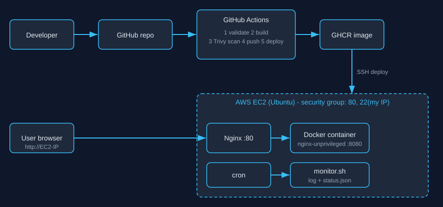

# Cloud-Native DevOps Deployment & Monitoring Platform

A beginner-friendly DevOps portfolio project: a Dockerized dashboard, deployed by GitHub Actions to AWS EC2 behind Nginx, with Trivy security scanning and Bash/cron server monitoring - all working together.

> **Honesty note:** see [docs/TESTING.md](docs/TESTING.md) for exactly what was verified when this project was generated (Bash monitor tested; Docker/Trivy/EC2/cron **not** run yet). Run the checklist yourself before claiming it in interviews.
> **Cost warning:** EC2 and related AWS services can incur charges. Terminate resources when done.

## 1. Introduction
The web app is a static dashboard (HTML/CSS/JS) showing deployment info, pipeline stages, live server metrics and security policy. The value is in the DevOps workflow around it.

## 2. Problem statement
Manual deployments are slow, error-prone and unmonitored. This project automates build -> scan -> publish -> deploy and keeps an eye on server health.

## 3. Objectives
Containerize an app securely - automate CI/CD - deploy reproducibly to EC2 - monitor with Bash + cron - gate releases with vulnerability scanning - document everything.

## 4. Technologies
HTML5/CSS3/JS - Docker & Compose - GitHub Actions - GHCR - AWS EC2 (Ubuntu) - Nginx - Bash & cron - Trivy - ShellCheck.

## 5. Architecture


Flow: `git push` -> Actions (validate -> build -> Trivy -> push) -> GHCR -> SSH deploy -> EC2: host Nginx (:80) -> container (:8080, non-root). `cron` runs `monitor.sh`, which writes a log and `status.json` that the dashboard displays.

## 6. Folder structure
```
.
|-- app/                      # index.html, css/style.css, js/app.js
|-- docker/nginx.conf         # container Nginx config (port 8080)
|-- Dockerfile  .dockerignore  docker-compose.yml  .env.example
|-- .github/workflows/ci-cd.yml
|-- monitoring/monitor.sh  setup-cron.sh
|-- scripts/trivy-scan.sh  validate.py
|-- deploy/ec2-bootstrap.sh  deploy/nginx/devops-platform.conf
|-- docs/  DEPLOYMENT.md TROUBLESHOOTING.md SECURITY.md TESTING.md RESUME_AND_INTERVIEW.md architecture.svg
`-- README.md  .gitignore
```

## 7. Local setup (Windows 10/11, PowerShell)
Install: [Docker Desktop](https://www.docker.com/products/docker-desktop/) (uses WSL2), [Git](https://git-scm.com/download/win), [VS Code](https://code.visualstudio.com/), Python 3.
```powershell
cd C:\path\to\devops-platform
python scripts\validate.py        # checks files exist, no secret patterns, JSON valid
```
Quick look without Docker: `cd app; python -m http.server 8000` -> http://localhost:8000 (stop with Ctrl+C). The Monitoring section says "no data" locally - expected.

## 8. Docker execution
```powershell
docker --version                                  # is Docker installed?
docker compose up -d --build                      # build the image and start the container in the background
docker ps                                         # STATUS should become "healthy" in ~30s
start http://localhost:8080                       # open in browser
curl.exe http://localhost:8080/healthz            # prints: ok
docker exec devops-platform id                    # shows uid=101 -> not root
docker logs devops-platform                       # view logs
docker compose down                               # stop and remove
```
Port busy? `$env:HOST_PORT=8081; docker compose up -d`.

## 9. GitHub repository setup
```powershell
git init
git add .
git status                       # make sure no .pem/.env files are listed!
git commit -m "Initial commit: DevOps platform"
git branch -M main
git remote add origin https://github.com/<YOUR_USER>/<YOUR_REPO>.git   # create an empty repo on github.com first
git push -u origin main
```

## 10. GitHub Actions configuration
1. Repo -> **Settings -> Secrets and variables -> Actions -> New repository secret**:
   | Secret | Value |
   |---|---|
   | `AWS_HOST` | EC2 public IPv4 or domain |
   | `AWS_USERNAME` | `ubuntu` |
   | `AWS_SSH_PRIVATE_KEY` | full contents of the `.pem` file (including BEGIN/END lines) |
   | `AWS_KNOWN_HOSTS` (optional, recommended) | output of `ssh-keyscan -t ed25519 <host>` |
   `GHCR_TOKEN` is **not needed**: the workflow uses the built-in short-lived `GITHUB_TOKEN`.
2. Repo -> Settings -> Actions -> General -> Workflow permissions: leave default (the workflow sets its own).
3. Optional: Settings -> Environments -> `production` -> add required reviewers for manual approval.
4. Push to `main`. Watch the **Actions** tab. Stages: Validate -> Build, scan, push -> Deploy. Pull requests run validate/build/scan only.
5. The first image push creates a private package under your profile/repo **Packages**; deployment pulls it with the workflow token.

## 11. AWS EC2 setup
Follow [docs/DEPLOYMENT.md](docs/DEPLOYMENT.md): create the instance and security group (SSH from your IP, HTTP 80), connect with SSH, run `deploy/ec2-bootstrap.sh`.

## 12. Nginx configuration
- `docker/nginx.conf`: inside the container; serves static files on 8080, `/healthz`, security headers.
- `deploy/nginx/devops-platform.conf`: on the EC2 host; reverse proxies port 80 -> `127.0.0.1:8080` and serves `/monitor/status.json`.
Test on the server: `sudo nginx -t` (syntax) and `sudo systemctl reload nginx`.

## 13. Linux monitoring
```bash
chmod +x monitoring/monitor.sh
./monitoring/monitor.sh                                    # readable output; exit 0 OK, 10 warnings, 1 error
CPU_THRESHOLD=70 MEM_THRESHOLD=75 DISK_THRESHOLD=85 ./monitoring/monitor.sh   # custom thresholds
STATUS_FILE=/tmp/status.json ./monitoring/monitor.sh       # also writes JSON for the dashboard
tail -n 20 logs/monitor.log                                # history
```
On Windows run it inside WSL (Ubuntu) or on EC2; it needs Linux `/proc`.

## 14. Cron configuration
```bash
STATUS_FILE=/var/lib/devops-monitor/status.json LOG_FILE=$HOME/monitor.log ./monitoring/setup-cron.sh 5   # every 5 min
crontab -l                      # verify the entry (marked "# devops-platform-monitor")
tail -f $HOME/monitor.log       # a new line should appear every 5 minutes
./monitoring/setup-cron.sh 1    # temporary 1-minute interval for testing
./monitoring/setup-cron.sh --remove
```
Manual test of exactly what cron runs: `env -i /bin/bash -c 'STATUS_FILE=... LOG_FILE=... /full/path/monitor.sh'` (cron has a minimal environment).

## 15. Trivy security scanning
- In CI: the workflow prints and uploads the full report (CRITICAL/HIGH/MEDIUM/LOW) and **fails on fixable CRITICAL** vulnerabilities. Policy and fixes: [docs/SECURITY.md](docs/SECURITY.md).
- Locally (Docker Desktop running; use Git Bash or WSL):
```bash
docker compose build
bash scripts/trivy-scan.sh devops-platform:local     # writes reports/trivy-report.txt and .json
```
- Or from PowerShell: `docker run --rm -v //var/run/docker.sock:/var/run/docker.sock aquasec/trivy:latest image devops-platform:local`
No scan results are included in this repo; they depend on the day you scan.

## 16. Testing instructions
Use the checklist in [docs/TESTING.md](docs/TESTING.md). Minimum demo path: validate -> compose up -> healthy -> Trivy report -> push -> green Actions run -> open EC2 IP -> show cron log.

## 17. Troubleshooting
See [docs/TROUBLESHOOTING.md](docs/TROUBLESHOOTING.md).

## 18. Screenshots
Add your own images to `docs/screenshots/` and link them here:
- [ ] Dashboard running locally
- [ ] `docker ps` showing healthy
- [ ] Green GitHub Actions run + Trivy artifact
- [ ] GHCR package page
- [ ] Dashboard on the EC2 public IP
- [ ] `crontab -l` and monitor log

## More
Resume text and interview Q&A: [docs/RESUME_AND_INTERVIEW.md](docs/RESUME_AND_INTERVIEW.md).
